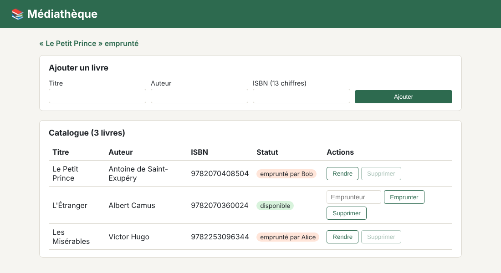

# 📚 Médiathèque : tests d'API (Postman, Robot Framework, SQL)

> Tester l'API REST d'une application de prêt de livres sous trois angles : **à la main avec Postman**, **automatiquement avec Robot Framework**, et **directement dans la base de données avec SQL**.


*Projet réalisé dans le cadre de ma formation de testeuse logicielle (titre RNCP niveau 5, ENI École Informatique). J'ai ensuite ajouté une base de données à l'application, pour pouvoir vérifier les données en SQL.*

---

## 📌 L'application testée : « Médiathèque »

Une application de gestion de prêts de livres : une **API REST** (Python Flask), une **interface web** qui l'utilise, et une **base de données** qui enregistre les livres et l'historique des emprunts.



| User story | Règles métier |
|---|---|
| **US-01** Consulter le catalogue | Liste des livres avec leur statut (disponible / emprunté par…) |
| **US-02** Ajouter un livre | Titre obligatoire (100 caractères max), auteur obligatoire, ISBN de **13 chiffres**, **unique** |
| **US-03** Emprunter un livre | Le livre doit être disponible, le nom de l'emprunteur est obligatoire |
| **US-04** Rendre un livre | Le livre doit être emprunté |
| **US-05** Supprimer un livre | Un livre emprunté ne peut pas être supprimé |

### Les points d'entrée de l'API

| Méthode | Adresse | Rôle | Réponses possibles |
|---|---|---|---|
| GET | `/api/livres` | Lister le catalogue | 200 |
| GET | `/api/livres/{id}` | Consulter un livre | 200, 404 |
| POST | `/api/livres` | Ajouter un livre | 201, 400, 409 |
| POST | `/api/livres/{id}/emprunt` | Emprunter | 200, 400, 404, 409 |
| POST | `/api/livres/{id}/retour` | Rendre | 200, 404, 409 |
| DELETE | `/api/livres/{id}` | Supprimer | 204, 404, 409 |
| POST | `/api/test/reset` | Remettre les données de référence (pour les tests) | 200 |

---

## 🧭 Trois façons de tester la même API

| | **Postman** | **Robot Framework** | **SQL** |
|---|---|---|---|
| **Pour quoi faire** | Explorer l'API, rejouer un scénario, déboguer | Rejouer toute la campagne automatiquement | Vérifier ce qui est **vraiment enregistré** |
| **Où** | [`postman/`](postman/) | [`tests/`](tests/) | [`sql/`](sql/) et [`tests/api/03_donnees_en_base.robot`](tests/api/03_donnees_en_base.robot) |
| **Quand** | Pendant la conception des tests | À chaque modification (intégration continue) | Après chaque action qui écrit des données |

---

## 1️⃣ Postman

📄 [`postman/Mediatheque-API.postman_collection.json`](postman/Mediatheque-API.postman_collection.json) · [`postman/donnees-invalides.csv`](postman/donnees-invalides.csv)

La collection est rangée par user story, avec des **tests automatiques dans chaque requête** :

```javascript
pm.test("Statut 409", () => pm.response.to.have.status(409));
pm.test("Message : Ce livre est déjà emprunté",
        () => pm.expect(pm.response.json().erreur).to.eql("Ce livre est déjà emprunté"));
// Vérifier l'état après l'action, avec une deuxième requête
pm.sendRequest(pm.collectionVariables.get("baseUrl") + "/api/livres/3", (err, res) => {
    pm.test("Le livre reste emprunté par Alice", () => pm.expect(res.json().emprunteur).to.eql("Alice"));
});
```

**Ce qui est utilisé :**
- une **variable de collection** `baseUrl` pour l'adresse de l'API ;
- un **script avant chaque requête** qui remet les données de référence : chaque requête peut être lancée seule ;
- des **requêtes enchaînées** (`pm.sendRequest`) pour vérifier l'état après une action ;
- une requête **pilotée par les données** : le dossier « Données invalides » se lance avec le **Collection Runner** et le fichier CSV (8 itérations, une par ligne) ;
- la vérification du **format des réponses** (champs, types, ISBN de 13 chiffres).

**Lancer :** démarrer l'application (voir plus bas), importer la collection dans Postman, puis clic droit sur la collection → **Run collection**. Pour le dossier « Données invalides », choisir le fichier `donnees-invalides.csv` dans le Runner.

**Résultat :** 22 requêtes testées, **56 vérifications réussies**.

---

## 2️⃣ Robot Framework

```text
tests/
├── __init__.robot                    démarre l'application avant la campagne, l'arrête après
├── resources/
│   ├── commun.resource               adresse, jeu de données de référence, démarrage de l'application
│   ├── api.resource                  mots-clés métier de l'API (RequestsLibrary)
│   └── base.resource                 mots-clés de vérification en base (DatabaseLibrary + SQL)
└── api/
    ├── 01_catalogue_api.robot        API-01 à API-15 : consultation, ajout, emprunt, retour, suppression
    ├── 02_donnees_invalides_api.robot  API-20 à API-27 : tests pilotés par les données
    └── 03_donnees_en_base.robot      BD-01 à BD-08 : contrôle des données en base
```

Les tests appellent des **mots-clés métier**, jamais directement les adresses de l'API :

```robotframework
API-09 Un livre déjà emprunté ne peut pas être emprunté
    ${reponse}=    Emprunter le livre    ${ID_MISERABLES}    Bob    statut_http=409
    Le message d'erreur est    ${reponse}    Ce livre est déjà emprunté
    ${livre}=    Consulter le livre    ${ID_MISERABLES}
    Le livre a le statut    ${livre}    emprunté    Alice
```

Les cas de données invalides utilisent un **modèle de test** (*Test Template*) : une ligne = un test.

```robotframework
*** Test Cases ***                  TITRE           AUTEUR         ISBN               MESSAGE ATTENDU
API-24 ISBN de 12 chiffres          Germinal        Émile Zola     978000000000       L'ISBN doit contenir exactement 13 chiffres
API-26 ISBN avec une lettre         Germinal        Émile Zola     978000000000X      L'ISBN doit contenir exactement 13 chiffres
```

**Résultat :** **31 tests, 31 réussis** (15 tests d'API, 8 tests pilotés par les données, 8 contrôles en base).

---

## 3️⃣ SQL : vérifier les données en base

Une réponse « 200 OK » de l'API ne prouve pas que les données ont été bien enregistrées. La base contient deux tables :

| Table | Contenu |
|---|---|
| `livres` | id, titre, auteur, isbn, emprunteur (vide si le livre est disponible) |
| `emprunts` | historique : livre, emprunteur, date d'emprunt, date de retour (vide si en cours) |

📄 [`sql/requetes-de-verification.sql`](sql/requetes-de-verification.sql) : 8 requêtes à lancer dans un client SQL (comme DBeaver), dont le **contrôle de cohérence** :

```sql
-- Un livre est emprunté si et seulement s'il a un emprunt en cours.
-- Résultat attendu : aucune ligne.
SELECT l.id, l.titre, l.emprunteur, e.id AS emprunt_en_cours
FROM livres l
LEFT JOIN emprunts e ON e.livre_id = l.id AND e.date_retour IS NULL
WHERE (l.emprunteur IS NULL) <> (e.id IS NULL);
```

Ces contrôles sont aussi **automatisés dans Robot Framework** (`03_donnees_en_base.robot`) :

```robotframework
BD-05 Un retour clôture l'emprunt en base
    Rendre le livre    ${ID_MISERABLES}
    L'emprunteur enregistré pour le livre est    ${ID_MISERABLES}    ${None}
    Le livre n'a aucun emprunt en cours    ${ID_MISERABLES}
    Le nombre d'emprunts terminés du livre est    ${ID_MISERABLES}    1
    Les livres et les emprunts sont cohérents
```

### 🧪 Preuve que les contrôles SQL sont utiles

J'ai introduit volontairement un bug dans l'application : **au retour d'un livre, l'historique n'est plus mis à jour**.

| Suite | Résultat avec le bug |
|---|---|
| Tests d'API (23 tests) | ✅ 23 / 23 : l'API répond normalement, **le bug passe inaperçu** |
| Contrôles en base (8 tests) | ❌ **BD-05 et BD-07 échouent** : le bug est détecté |

> 💡 Un test d'API vérifie la **réponse** ; un contrôle SQL vérifie l'**effet**. Les deux sont complémentaires.

---

## ▶️ Lancer le projet

```bash
pip install -r requirements.txt

# Lancer l'application seule (pour Postman ou l'interface web)
python app/app.py                 # puis ouvrir http://127.0.0.1:5000

# Lancer toute la campagne Robot Framework (l'application démarre toute seule)
robot --outputdir results tests

# Lancer une partie seulement
robot --outputdir results --include smoke tests     # tests essentiels
robot --outputdir results --include sql tests       # contrôles en base
```

Le rapport est dans `results/report.html`.

## ⚙️ Intégration continue

À chaque `push`, GitHub Actions installe l'environnement, lance la campagne Robot Framework et publie les rapports ([`.github/workflows/tests-api.yml`](.github/workflows/tests-api.yml)). Le résultat est visible dans l'onglet **Actions** du dépôt.

## 🗂️ Contenu du dépôt

```text
├── app/                      l'application testée (API + interface web + base de données)
├── postman/                  la collection Postman et le fichier de données CSV
├── tests/                    la campagne Robot Framework
├── sql/                      les requêtes SQL de vérification
├── docs/                     capture de l'application
└── .github/workflows/        l'intégration continue
```
